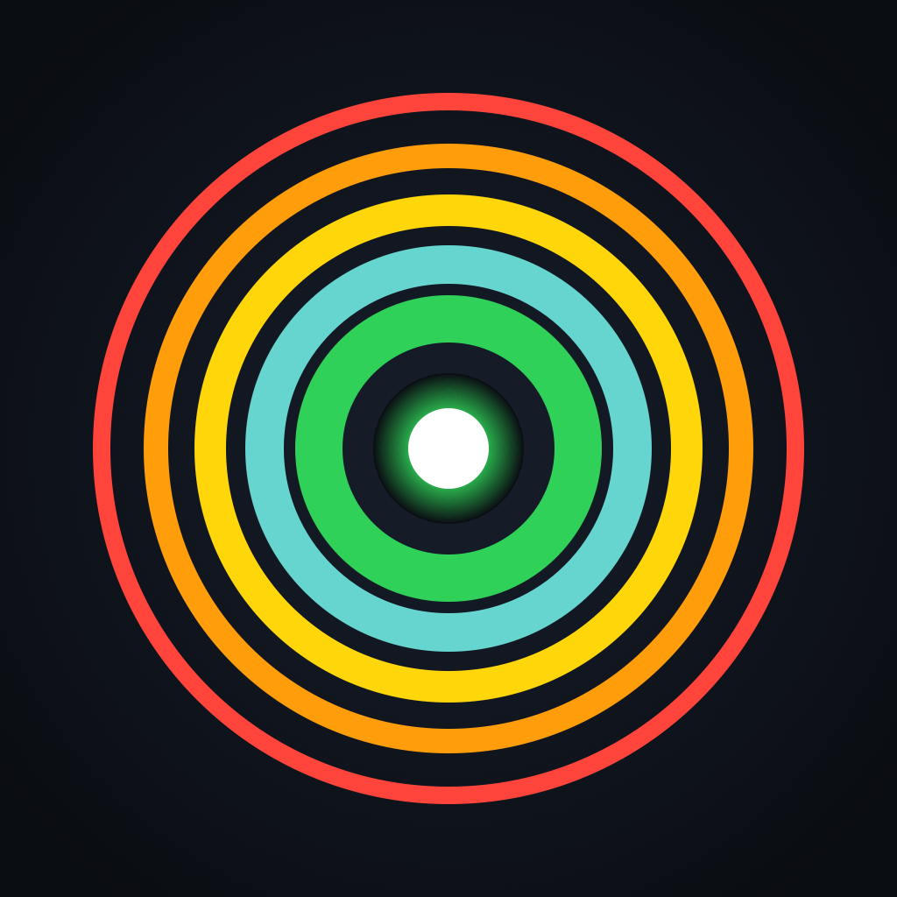

<div align="center">



# Dowser

**Walk down a lost Apple device by its Bluetooth signal — from an iPhone, an iPad, or the command line.**

</div>

A dowsing rod is a stick that twitches when you are near the thing you are
looking for. That is the whole idea here: no map, no bearing, no ringing —
just a number that rises, clicks that quicken and, on a phone, a buzz that
turns solid when the device is within reach. You sweep the room; the room
tells you when you are warm.

It is built for the case where Find My is not available — a device enrolled in
MDM that disables it, a handset that is logged out, an AirTag that answers to
someone else's account — but the thing is still in the house with its radio on.

---

## Credit where it is due

**Dowser is built on [`findphone`](https://github.com/ben-z/findphone) by
[Ben Zhang](https://github.com/ben-z).**

Ben wrote the original macOS command-line tool: the three-source signal
tracker, the median-smoothed reading, the trend detector, the proximity bands,
the terminal display and the parking-sensor clicks. That work is the heart of
this repository and all of it is still here. This fork keeps his commit history
intact — `git log` shows his authorship on every one of the original commits —
and the upstream repository stays wired up as a remote:

```sh
git remote -v
# upstream  https://github.com/ben-z/findphone.git
```

What has been added on top: a wider Apple-device sweep, an iPhone and iPad app,
haptics, tests and this README. Details in [What this fork adds](#what-this-fork-adds).

> [!IMPORTANT]
> The upstream repository carries **no LICENSE file**, which under default
> copyright means all rights are reserved by its author. Attribution is not the
> same as permission: nothing here grants you — or this fork — the right to
> redistribute Ben's code. If you intend to use or build on this, ask Ben to
> add a licence first. If you are Ben and you would rather this fork did not
> exist, open an issue and it comes down.

---

## What it does

Two things, sharing one engine:

| | |
|---|---|
| **Survey** | Lists every Apple device advertising nearby, strongest signal first, labelled with what each appears to be — iPhone, Watch, AirPods, AirTag, Apple TV, HomePod, Mac. |
| **Hunt** | Locks onto one of them and turns the screen into a single reading you can walk behind: number, proximity band, trend arrow, bar, and a bar-per-measurement history. Clicks and buzz for walking with your eyes up. |

The reading is signal strength in dBm — negative, and closer to zero when
nearer:

| dBm | Rough meaning |
|---|---|
| -45 and up | arm's reach |
| -60 | same table |
| -72 | same room |
| -85 | far, or behind cover |
| below | very far, or shielded |

Signal strength is a coarse proxy for distance. Metal, walls and human bodies
attenuate it heavily, so a device in a filing cabinet two metres away can read
the same as one fifteen metres away in open air. **Trust the trend as you move,
not any single number.** Walk a few metres, stand still for ten seconds, read
the arrow.

---

## The app

Universal iPhone and iPad, SwiftUI, no dependencies. On an iPad the list and
the reading sit side by side; on a phone the list pushes to the reading. The
Xcode project is generated from `App/project.yml` rather than committed, so
there are no 30,000-line `.pbxproj` conflicts:

```sh
brew install xcodegen          # once
cd App && xcodegen generate
open Dowser.xcodeproj          # set your team under Signing & Capabilities
```

**Run it on real hardware.** A simulator has no Bluetooth radio at all and can
only report that it has none. For working on the interface without a radio, the
app takes a `-demo` launch argument that fills the list with a stand-in house.

### Sound

A click that quickens as you close, like a parking sensor — about one a second
across a room, rising to a buzz around -50 dBm, which is roughly where a laptop
reads when it is resting on top of the phone. Clicks stop when contact goes
stale, so silence means *no signal*, not *no device*.

The click is synthesised in memory rather than shipped as an asset, and plays
through the `playback` audio category, so you can hear it with the ringer
switched off — which is the state a phone that has gone missing is usually in.

This is **not** a Geiger counter, despite sounding a bit like one. A counter
clicks once per detected particle and the rate *is* the measurement; here the
rate is computed from the smoothed signal, because packets arrive on a fixed
polling timer and their arrival rate says almost nothing about distance.

### Buzz

On a device with a Taptic Engine the hunt also buzzes. It ramps deliberately
differently from the clicks — clicks run the whole walk and carry their meaning
in their rate, so a buzz doing the same would say nothing:

| Reading | What you feel |
|---|---|
| below -72 dBm | nothing at all |
| -72 to -46 | taps on the click's clock, firming up as you close |
| -45 and up | one continuous buzz — it is within arm's reach |

Stillness therefore means "not close yet", and a buzz means "here". It arms
itself when a hunt starts, with a toggle next to the sound.

> [!NOTE]
> **No iPad has a Taptic Engine** — not even the Pro. iPadOS cannot do haptics
> at all. Dowser asks the hardware (`CHHapticEngine.capabilitiesForHardware()`)
> and hides the control rather than offering a switch that does nothing, so on
> an iPad the sound is the whole of the eyes-free feedback.

### What the app cannot do that the Mac can

The gap is the platform, not the port:

| | macOS CLI | iOS / iPadOS app |
|---|---|---|
| BLE advertisements | yes | yes |
| GATT link RSSI, ~3/s | yes | yes |
| Classic RSSI of paired devices | yes | no `system_profiler`, no classic radio |
| Bluetooth addresses | yes | never exposed to apps; a per-app UUID instead |
| Listing paired devices | `--list` | no equivalent API |
| Scanning while backgrounded | yes | suspends; keep it frontmost |

---

## The command line

```sh
swift build -c release
cp .build/release/findphone ~/bin/findphone
```

Requires the Swift toolchain from Xcode Command Line Tools. For a universal
arm64 + x86_64 binary, which is what CI ships:

```sh
./scripts/build-universal.sh dist
```

```sh
findphone            # survey: every nearby Apple device, by signal
findphone iphone     # hunt: track one device by name (case-insensitive)
findphone --list     # paired devices and their addresses
findphone --sound    # clicks that quicken as you close (hunt mode)
findphone --all      # survey non-Apple hardware too
findphone --raw      # print advertisements as they arrive, instead of drawing
findphone --redact   # mask addresses and names, for screen recording
```

Survey mode also shows what is paired with this Mac and currently reporting a
signal, underneath the BLE list — a Mac or a HomePod can go minutes without
sending a packet and would otherwise be missing from a list of the house.

`--redact` masks Bluetooth addresses and, in survey mode, replaces discovered
names with the device kind, since those names are not always yours. A public
address is a stable hardware identifier and, unlike a BLE advertising address,
does not rotate — worth keeping out of a video. Two things stay visible on
purpose: the name you typed in hunt mode, and the names in `--list`, because
picking a target means reading them. **`--list` is not safe to film even with
`--redact`.**

---

## How it works

Three sources feed one reading, in descending order of quality:

1. **GATT link** — once connected to the device over BLE, `readRSSI()` returns
   a fresh measurement about three times a second. This is the good one.
2. **BLE advertisements** — passively observed. Apple devices rotate their
   advertising addresses roughly every fifteen minutes and only include the
   device name on occasional packets, so this source is sparse.
3. **Classic link RSSI** — read from `system_profiler SPBluetoothDataType`,
   keyed by the stable public address of a paired device. macOS only.

Source 3 has a trap worth knowing about: macOS refreshes that value only every
three to twelve seconds and serves a cached number in between. Polling it
faster does not yield more information. Measured over 112 polls at 0.4s, every
poll returned a value but the same value repeated for runs of 8 to 31 polls.
The tool therefore counts a measurement only when the value actually changes,
which is why the reported measurement count is far lower than the poll rate —
and honest.

### Telling the devices apart

Every Apple device broadcasts small unencrypted
[Continuity](https://petsymposium.org/popets/2019/popets-2019-0057.pdf)
messages — the machinery behind Handoff, AirDrop, instant AirPods pairing and
the rest. Dowser reads which *kinds* of message a device is sending and infers
what it is:

| Message | What sends it |
|---|---|
| Proximity Pairing | AirPods and Beats — and it carries the model in the clear |
| Magic Switch | Apple Watch, reporting wrist state |
| Tethering Source | a phone, because only a phone offers a hotspot |
| AirPlay Target | Apple TV, HomePod |
| Find My | an AirTag, or any Apple device out of touch with its owner |
| Handoff, Nearby Info, AirDrop, HomeKit | anything Apple |

This is a hint, not an identification. Several kinds share a message, a device
only sends what it currently has to say, and none of it is documented by Apple
— the mapping comes from published protocol analysis. `findphone --raw` prints
the advertisements themselves, so a label that looks wrong can be checked
against the bytes that produced it, and the table corrected.

---

## What this fork adds

- **Every Apple device, not just handhelds.** Upstream surveyed five Continuity
  message types; Dowser decodes the full set plus Find My service data and
  labels each device by kind. Survey on macOS also merges in paired devices,
  which is how Macs and HomePods stop being invisible.
- **An iPhone and iPad app**, sharing the tracker with the command line.
- **Haptics**, gated to close range, keyed to the same proximity bands the
  screen reports.
- **A portable core.** The scanning engine moved to `FindPhoneKit`, which
  compiles for both platforms; `system_profiler` and everything else
  macOS-only sits behind an injected `AuxiliarySource`.
- **Tests**, where there were none: the Continuity parser, the kind inference,
  both feedback ramps, and a UI test for the list-to-hunt navigation.
- **`--all` and `--raw` flags**, an app icon, and CI that builds the app and
  runs both suites.

## Layout

```
Sources/FindPhoneKit/       the scanning engine, shared — portable to iOS
Sources/findphone/          the terminal front end, macOS only
App/Sources/                the SwiftUI app
App/UITests/                navigation tests, driven with -demo
App/Icon/make-icon.swift    renders the icon; run it rather than hand-editing a PNG
Tests/FindPhoneKitTests/    unit tests for the engine
```

## Tests

```sh
swift test                                   # the shared engine
cd App && xcodebuild test -scheme Dowser \
  -destination 'platform=iOS Simulator,name=iPhone 16 Pro'   # or any iPhone you have
```

CI picks whichever simulator the runner happens to ship rather than naming a
model, because Apple retires simulator images without warning.

## Permissions

The CLI needs Bluetooth access for whichever terminal runs it, under
System Settings > Privacy & Security > Bluetooth. It says so if it is missing.
The app asks on first launch and explains why in the prompt.

## Limitations

- **Cannot make a device ring.** There is no path to that without Find My.
- **Cannot give a bearing.** One radio yields distance only, not direction.
- Only finds devices with Bluetooth powered on and in range — roughly 10-20 m
  indoors, much less through walls.
- **Cannot count the house reliably.** Apple devices rotate their BLE
  advertising address every fifteen minutes or so, and nothing in an
  advertisement ties the old address to the new one, so a device that sits
  still long enough eventually appears as a fresh entry. Rows that stop
  advertising age out after twenty seconds, which stops the list growing
  without limit but does not merge them.
- **A device seen over BLE is not necessarily yours.** Advertisements from a
  neighbour's flat carry nothing that distinguishes them from your own, which
  is why the paired section and `--redact` exist.
- The kind labels are inference, not identification. See
  [Telling the devices apart](#telling-the-devices-apart).

---

<div align="center">
<sub>Original tool by <a href="https://github.com/ben-z">Ben Zhang</a> ·
<a href="https://github.com/ben-z/findphone">ben-z/findphone</a></sub>
</div>
